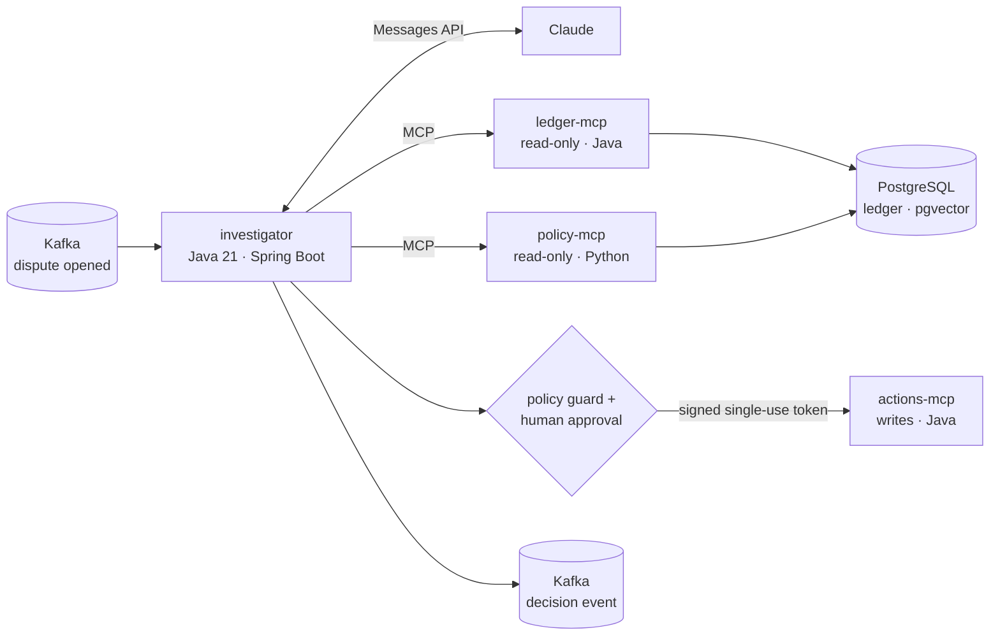

# dispute-resolution-agent

[](https://github.com/M-Touiti/dispute-resolution-agent/actions/workflows/ci.yml)
[](https://github.com/M-Touiti/dispute-resolution-agent/actions/workflows/codeql.yml)
[](LICENSE)

A production-shaped agent that investigates card disputes through MCP tool servers, cites its evidence, cannot
touch money without a human, and is scored by an evaluation suite on every pull request.

> **Status: M0 (skeleton) complete; M1 (the agent loop) next.** The infrastructure, data and tool contracts exist
> and are tested; the agent does not yet investigate anything, so there are **no results yet**. The results table
> replaces this notice at M3. Progress: [docs/ROADMAP.md](docs/ROADMAP.md).

## What it is

A Kafka event opens a dispute. An agent built on Claude investigates it through three Model Context Protocol (MCP)
servers, cites the evidence and the policy section it relied on, and proposes a decision as a validated structured
object. A deterministic policy guard checks the decision. The agent can act (provisional credit, merchant evidence
request, closure) only through a human approval gate, and the write server verifies the approval token itself
rather than trusting the agent. Every step is audited, traced, metered for tokens and cost, load-tested, and scored
by an evaluation harness that gates merges.



## What exists today (M0)

| Part | State | Tests |
|---|---|---|
| `investigator/` | Hexagonal Maven modules. `domain`: the `Decision` and its structured-output schema, a deterministic `PolicyGuard`, the case state machine and loop caps. `application`: triage and the hand-written investigation loop over `LlmPort` and `McpToolPort`, with two Agent Skills loaded on demand, tested with fake ports. `adapters`: the Anthropic SDK adapter with cost per call, JSON and schema validation; MCP, Kafka and database adapters follow | 111 |
| `data/` | Seeded synthetic data generator: cardholders, cards, merchants, authorisations, transactions and disputes across 5 categories and 17 scenarios, with ground truth kept apart for evaluation. Same seed, same bytes | 21 |
| `mcp-servers/ledger-mcp` | Six read-only tools over Streamable HTTP, answering from PostgreSQL as a role that can only read the ledger; bounded, paginated results; `tools/list` pinned by a contract test | 37 |
| `mcp-servers/policy-mcp` | Two read-only tools (`mcp` 2.3.0 in FastAPI) over the policy corpus in PostgreSQL: hybrid full-text and vector retrieval with a local model, a retrieval-quality floor in CI | 32 |
| `mcp-servers/actions-mcp` | Three write tools, each requiring an `approval_token`; every call is rejected until token verification lands in M2 | 16 |
| `deploy/compose/` | PostgreSQL 18 + pgvector loaded with the seed, Kafka 4.2 (KRaft), the three servers; `smoke.sh` checks all of them | smoke |
| CI | Build and tests per module, lint, compose smoke test, CodeQL (Java, Python, workflows), Dependabot | |

Every tool's input schema stays inside the JSON Schema subset that strict tool use accepts, and a test in each
server enforces it. The schemas can be passed to Claude unchanged.

## Run it

Prerequisites: JDK 21, [uv](https://docs.astral.sh/uv/), Docker. No API key is needed for anything in M0.

```sh
# Generate the synthetic data (seed 20261101 by default)
cd data && uv run python generate.py && cd ..

# Start PostgreSQL, Kafka and the three MCP servers, then check them
cd deploy/compose
docker compose up -d --build --wait
./smoke.sh            # Git Bash on Windows
docker compose down -v
```

Each module builds and tests on its own. CI runs the same commands:

```sh
cd investigator && ./mvnw verify                      # also mcp-servers/ledger-mcp, mcp-servers/actions-mcp
cd data && uv run pytest && uv run ruff check .        # also mcp-servers/policy-mcp
```

The MCP servers listen on `localhost:8081` (ledger), `8082` (policy) and `8083` (actions) at `/mcp`. Live model
runs from M1 need `ANTHROPIC_API_KEY` in `.env` (see [.env.example](.env.example)); CI replays recorded responses
and never calls the API.

## Layout

```
investigator/        Java 21, Spring Boot 4: domain, application (ports, use cases), adapters, bootstrap
mcp-servers/         ledger-mcp (Java), policy-mcp (Python), actions-mcp (Java); each has its own README
data/                seeded synthetic data generator; policy corpus (Markdown, 24 sections)
evals/               golden set, graders, recorded fixtures, REPORT.md (M1 to M3)
skills/              Agent Skills (SKILL.md) the investigator loads on demand
performance/         k6 scripts and failure injection (M2)
deploy/              docker compose; Kustomize manifests (M2)
docs/                roadmap, architecture decision records, diagrams
```

## Design decisions

| ADR | Decision | Status |
|---|---|---|
| [0001](docs/adr/0001-scope-and-provider-port.md) | Scope, and an `LlmPort` with live, recording and replay adapters, so CI replays fixtures and model ids live in configuration | accepted |
| [0002](docs/adr/0002-manual-agent-loop.md) | A hand-written agent loop rather than the SDK tool runner, so the model call stays behind the replayable `LlmPort` and tools can be discovered at runtime | accepted |
| [0003](docs/adr/0003-self-hosted-mcp-servers-and-client.md) | Self-hosted MCP servers and our own client on the raw MCP Java SDK, rather than the Messages API MCP connector or Spring AI: private servers, every call gated before it runs | accepted |
| [0004](docs/adr/0004-local-embedding-model.md) | A local embedding model behind a port, baked into the image: one API key, no network in replay | accepted |
| 0005 | Approval tokens verified inside the write server, not only in the client | planned (M2) |
| 0006 | Recorded fixtures for CI and a nightly live evaluation slice with a spend cap | planned (M1 / M3) |
| [0007](docs/adr/0007-embedding-model-and-fusion-measured-on-the-corpus.md) | `bge-small-en-v1.5` and hybrid retrieval with full text at half weight, chosen by measuring 45 questions on the real corpus; supersedes 0004's model | accepted |

The index with full titles is in [docs/adr](docs/adr/README.md); pinned versions are in the
[roadmap](docs/ROADMAP.md#pinned-versions-verified-against-maven-central-and-pypi-on-1-nov-2026).

## Milestones

| Milestone | Done means |
|---|---|
| **M0 Skeleton** (done) | Module layout, data generator, three MCP servers answering `tools/list`, compose, CI and CodeQL green |
| M1 Loop | One category end to end through both read servers, with a structured decision, guard and audit; 30 golden cases replayed in CI |
| M2 Production half | Approval gate and token verification, resilience, DLQ and outbox, traces and dashboards, load and failure tests, Kubernetes manifests |
| M3 Evidence | All categories including two adversarial ones, 150+ golden cases, live evaluation, `evals/REPORT.md`, tag `v0.1.0` |
| M4 Write-up | What the evaluations found, the two hardest failures, what the approval gate caught |

## Out of scope

Real network reason codes, real chargeback submission, PCI data, multi-currency, fraud models (the synthetic data
carries a fraud flag; the agent reads it, it does not compute it).

## Provenance

All data is synthetic and generated by a seeded script in this repository. The policy corpus is self-written.
Nothing here is derived from any employer. See [SECURITY.md](SECURITY.md).

## License

[MIT](LICENSE).
