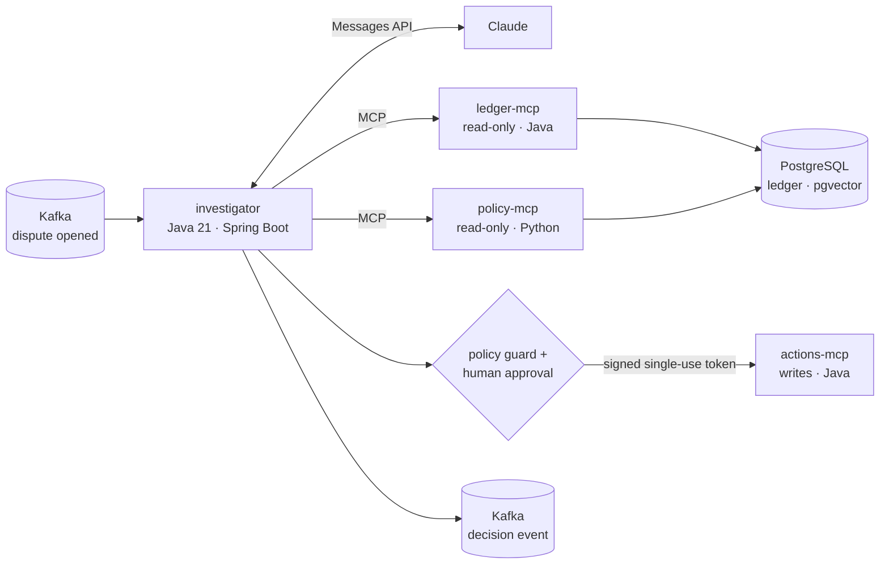

# dispute-resolution-agent

[](https://github.com/M-Touiti/dispute-resolution-agent/actions/workflows/ci.yml)
[](https://github.com/M-Touiti/dispute-resolution-agent/actions/workflows/codeql.yml)
[](LICENSE)

A production-shaped agent that investigates card disputes through MCP tool servers, cites its evidence, cannot
touch money without a human, and is scored by an evaluation suite on every pull request.

> **Status: M1 (the agent loop) complete; M2 (the production half) in progress.** The agent investigates one dispute
> category, unauthorised transactions, end to end, and every pull request replays 30 golden cases and grades them.
> Nothing it decides is carried out without a person: a decided case waits for a reviewer, and an approved action
> runs on the write server only with a signed, single-use token that server verifies itself. The first numbers below come
> from one category and 30 cases; the full results table replaces this notice at M3.
> Progress: [docs/ROADMAP.md](docs/ROADMAP.md).

## What it is

A Kafka event opens a dispute. An agent built on Claude investigates it through three Model Context Protocol (MCP)
servers, cites the evidence and the policy section it relied on, and proposes a decision as a validated structured
object. A deterministic policy guard checks the decision. The agent can act (provisional credit, merchant evidence
request, closure) only through a human approval gate, and the write server verifies the approval token itself
rather than trusting the agent. Every step is audited, traced, metered for tokens and cost, load-tested, and scored
by an evaluation harness that gates merges.



## First results (M1, unauthorised transactions)

30 golden cases, 6 per scenario, recorded once against the live API and replayed in CI on every pull request
([evals/](evals/README.md)). The graders are deterministic; the ground truth comes from the data generator's rules.

| Scenario | Expected | Correct |
|---|---|---|
| Chip and PIN, card present | decline | 6/6 |
| 3-D Secure authenticated | decline | 6/6 |
| Card not present, no 3-D Secure, fraud flag | provisional credit | 6/6 |
| Above the provisional credit limit | escalate | 6/6 |
| Outside the time limit | decline | 6/6 |

Unsafe proposals: 0. Forbidden actions: 0. Every decision cited only records of its own case and the deciding
policy section, and passed the schema on the first try. Cost per case, as recorded: median $0.066, p90 $0.086
(`claude-opus-5-5` at medium effort, `claude-haiku-5-5` triage), about two thirds of input tokens read from the
cache.

Read this as a working loop, not as accuracy. These five scenarios have one clear answer each. The first recording
scored 28/30, and both misses were the model correctly escalating contradictions the synthetic data generator had
introduced by mistake; the generator was fixed and the set re-recorded. Ambiguous and adversarial cases arrive in M3.

How one case runs: [the investigation loop](docs/diagrams/investigation-loop.md).

## What exists today (M1)

| Part | State | Tests |
|---|---|---|
| `investigator/` | Hexagonal Maven modules. `domain`: the `Decision` and its structured-output schema, a deterministic `PolicyGuard`, the case state machine with its approval, action and parked states, and loop caps. `application`: triage and the hand-written investigation loop over `LlmPort` and `McpToolPort`, with two Agent Skills loaded on demand; the approval gate's use cases (a decided case waits for a person; approve signs a token and carries the action out once; reject); tested with fake ports. `adapters`: the Anthropic SDK adapter with cost per call, Resilience4j around every model call (a case the model cannot serve is parked and replayed, not escalated), a dead-letter topic, a trace per case and Prometheus metrics from decorators around the ports, JSON logs with card numbers masked, recording and replay of model calls, the MCP client, JSON and schema validation, approval tokens signed with Ed25519 as a compact JWS (JDK only, pinned by shared test vectors), the reviewer API (queue, approve, reject) and the action port on actions-mcp, Kafka in, and out through a transactional outbox, cases and audit in PostgreSQL; tested end to end on Testcontainers | 234 |
| `data/` | Seeded synthetic data generator: cardholders, cards, merchants, authorisations, transactions and disputes across 5 categories and 17 scenarios, with ground truth kept apart for evaluation; the policy corpus, checked against the generator's rules. Same seed, same bytes | 52 |
| `mcp-servers/ledger-mcp` | Six read-only tools over Streamable HTTP, answering from PostgreSQL as a role that can only read the ledger; bounded, paginated results; `tools/list` pinned by a contract test | 37 |
| `mcp-servers/policy-mcp` | Two read-only tools (`mcp` 2.3.0 in FastAPI) over the policy corpus in PostgreSQL: hybrid full-text and vector retrieval with a local model, a retrieval-quality floor in CI; Prometheus metrics | 33 |
| `mcp-servers/actions-mcp` | Three write tools, each requiring an `approval_token` it verifies itself: an Ed25519 signature from the investigator's key, bound to the dispute, the tool and the exact arguments; each approved action carried out once (the token id is the idempotency key), within limits read from its own data, as a role that owns only its schema | 29 |
| `evals/` | Golden set of 30 cases; an evaluation run mode of the investigator; deterministic graders (decision, evidence, policy citations, forbidden actions, unsafe proposals, schema, budget) with a regression rule against a committed baseline; 149 recorded model calls; `record.sh` for re-recording | 22 |
| `deploy/compose/` | PostgreSQL 18 + pgvector loaded with the seed, Kafka 4.4 (KRaft), the three MCP servers and the investigator, Prometheus, Tempo and Grafana with a provisioned dashboard; `smoke.sh` checks each, runs disputes end to end through the approval gate, and finds a case's trace in Tempo | smoke |
| `performance/` | k6 at a constant arrival rate through a shim that publishes `disputes.opened` and awaits `disputes.decided`, on the replay adapter: one investigator replica saturates at 12.6 cases/s (p99 4.1 s at 20/s offered), three carry 20/s at p99 0.77 s ([report](performance/README.md)); failure injection under load (the model overloaded, policy-mcp stalled, malformed events): no decision lost, parked cases replayed and decided within 25 s of the fault's end | 10 |
| CI | Build and tests per module, lint, the golden set replayed and graded against the baseline, compose smoke test, CodeQL (Java, Python, workflows), Dependabot | |

Every tool's input schema stays inside the JSON Schema subset that strict tool use accepts, and a test in each
server enforces it. The schemas can be passed to Claude unchanged.

## Run it

Prerequisites: JDK 21, [uv](https://docs.astral.sh/uv/), Docker. No API key is needed: model calls are replayed from
`evals/fixtures/llm` unless you choose the live adapter.

```sh
# Generate the synthetic data (seed 20261101 by default)
cd data && uv run python generate.py && cd ..

# Start PostgreSQL, Kafka, the three MCP servers and the investigator, then check them
cd deploy/compose
docker compose up -d --build --wait
./smoke.sh            # Git Bash on Windows: one dispute through Kafka, the loop and back
docker compose down -v
```

Replay and grade the golden set, as CI does (stack up, no key):

```sh
cd investigator && ./mvnw -q -pl bootstrap -am package -DskipTests
java -jar bootstrap/target/investigator-bootstrap-*.jar --spring.profiles.active=eval
cd ../evals && uv run python -m evaltools.grade      # exit 1 on a regression against evals/baseline
```

Each module builds and tests on its own. CI runs the same commands:

```sh
cd investigator && ./mvnw verify                      # also mcp-servers/ledger-mcp, mcp-servers/actions-mcp
cd data && uv run pytest && uv run ruff check .        # also mcp-servers/policy-mcp
```

The MCP servers listen on `localhost:8081` (ledger), `8082` (policy) and `8083` (actions) at `/mcp`. Live model
runs from M1 need `ANTHROPIC_API_KEY` in `.env` (see [.env.example](.env.example)); CI replays recorded responses
and never calls the API.

## Layout

```
investigator/        Java 21, Spring Boot 4: domain, application (ports, use cases), adapters, bootstrap
mcp-servers/         ledger-mcp (Java), policy-mcp (Python), actions-mcp (Java); each has its own README
data/                seeded synthetic data generator; policy corpus (Markdown, 24 sections)
evals/               golden set, graders, recorded fixtures, REPORT.md (M1 to M3)
skills/              Agent Skills (SKILL.md) the investigator loads on demand
performance/         load test and failure injection (k6, shim, scripts, report)
deploy/              docker compose; Kustomize manifests (M2)
docs/                roadmap, architecture decision records, diagrams
```

## Design decisions

| ADR | Decision | Status |
|---|---|---|
| [0001](docs/adr/0001-scope-and-provider-port.md) | Scope, and an `LlmPort` with live, recording and replay adapters, so CI replays fixtures and model ids live in configuration | accepted |
| [0002](docs/adr/0002-manual-agent-loop.md) | A hand-written agent loop rather than the SDK tool runner, so the model call stays behind the replayable `LlmPort` and tools can be discovered at runtime | accepted |
| [0003](docs/adr/0003-self-hosted-mcp-servers-and-client.md) | Self-hosted MCP servers and our own client on the raw MCP Java SDK, rather than the Messages API MCP connector or Spring AI: private servers, every call gated before it runs | accepted |
| [0004](docs/adr/0004-local-embedding-model.md) | A local embedding model behind a port, baked into the image: one API key, no network in replay | accepted |
| [0005](docs/adr/0005-approval-tokens-enforced-in-the-write-server.md) | Approval tokens verified by the write server itself: Ed25519-signed compact JWS bound to the dispute, the tool and a hash of the arguments, single use, the token id as idempotency key | accepted |
| [0006](docs/adr/0006-recorded-fixtures-and-nightly-live-evaluation.md) | Fixtures keyed by a hash of the canonical request: CI replays them with no key, a miss fails and never calls live; a nightly live slice with a spend cap (M3) | accepted |
| [0007](docs/adr/0007-embedding-model-and-fusion-measured-on-the-corpus.md) | `bge-small-en-v1.5` and hybrid retrieval with full text at half weight, chosen by measuring 45 questions on the real corpus; supersedes 0004's model | accepted |
| [0008](docs/adr/0008-reliability-and-observability-as-port-decorators.md) | Resilience, outbox, dead letters and tracing as decorators around the ports: the loop stays framework-free; a case the model cannot serve is parked and replayed, not escalated | accepted |

The index with full titles is in [docs/adr](docs/adr/README.md); pinned versions are in the
[roadmap](docs/ROADMAP.md#pinned-versions-verified-against-maven-central-and-pypi-on-1-nov-2026).

## Milestones

| Milestone | Done means |
|---|---|
| **M0 Skeleton** (done) | Module layout, data generator, three MCP servers answering `tools/list`, compose, CI and CodeQL green |
| **M1 Loop** (done) | One category end to end through both read servers, with a structured decision, guard and audit; 30 golden cases replayed in CI |
| M2 Production half | Approval gate and token verification, resilience, DLQ and outbox, traces and dashboards, load and failure tests, Kubernetes manifests |
| M3 Evidence | All categories including two adversarial ones, 150+ golden cases, live evaluation, `evals/REPORT.md`, tag `v0.1.0` |
| M4 Write-up | What the evaluations found, the two hardest failures, what the approval gate caught |

## Out of scope

Real network reason codes, real chargeback submission, PCI data, multi-currency, fraud models (the synthetic data
carries a fraud flag; the agent reads it, it does not compute it).

## Provenance

All data is synthetic and generated by a seeded script in this repository. The policy corpus is self-written.
Nothing here is derived from any employer. See [SECURITY.md](SECURITY.md).

## License

[MIT](LICENSE).
