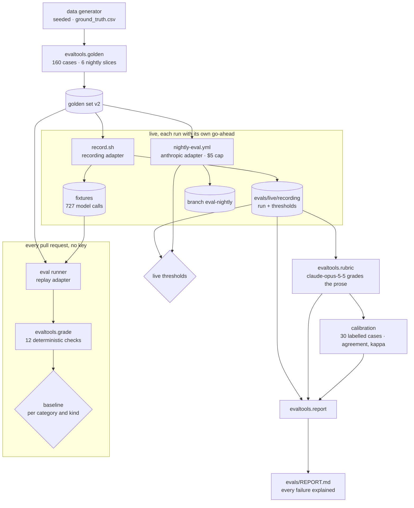

# The evaluation (M3)

How the numbers in [`evals/REPORT.md`](../../evals/REPORT.md) are made, and how the same golden set gates every pull
request without calling the API (ADR 0006, ADR 0009). The ground truth comes from the data generator's rules and is
never shown to the agent or to the rubric's grader.

- **Replay** (CI): a request whose hash has no fixture fails the run; it never falls through to the live API. A
  change to anything the model sees misses every fixture and is re-recorded in the same pull request.
- **Grading**: decisions, citations, actions, amounts and injections are checked deterministically; only the
  rationale and the merchant request go to the model-graded rubric, published per criterion only where its agreement
  with the calibration labels reaches 0.8 and kappa 0.6.
- **Live runs** are not byte-stable, so they are graded on per-case thresholds written from the full recording, not
  on the replay baseline. Nightly results go to `eval-nightly`, never to `main`.
