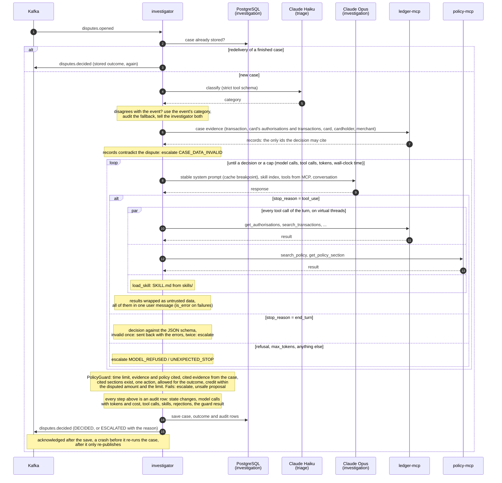

# The investigation loop (M1)

One `disputes.opened` event to one `disputes.decided` event. The loop is hand-written over `LlmPort` (ADR 0002);
the model only reaches tools through the investigator, which routes each call to an allowlisted MCP server
(ADR 0003). The actions server is not reachable in M1: every outcome is a proposal.

Since M2 the end of this diagram is different: the case and its events are saved in one transaction and an outbox
relay publishes them, a decided case with an action waits for a reviewer, and a model or server outage parks the case
instead of escalating it. See [approval-and-parking.md](approval-and-parking.md).

In evaluation (`--spring.profiles.active=eval`) the same `HandleDisputeOpened` runs without Kafka and PostgreSQL:
disputes come from `data/generated`, audit rows stay in memory, and each case becomes a result file for the graders.
With `LLM_ADAPTER=replay` the two Claude participants are served from `evals/fixtures/llm` (ADR 0006).
